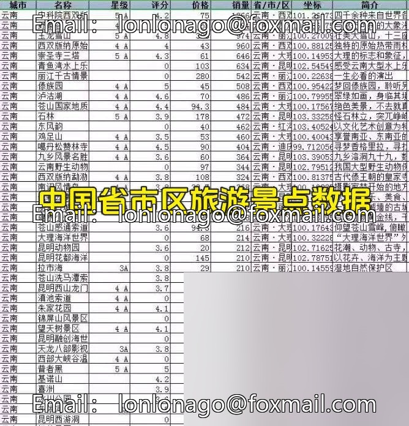

# Chinese province, city, and district tourism attraction data

## Body

China provincial city district tourist attraction data

Data fields:
No. city name description star rating score price sales quantity province/city/district coordinates whether free specific address

A total of 2442 data

web-based shipment, can be directly photographed and shipped.

The fields include sequence, city, name, introduction, star rating, score, price, sales volume, province/city/zone, coordinates, whether free and specific address; the content shows sales volume and province/city/zone information.

<!-- AI_ENRICHED -->

## Images

## Payment

Here is a pay link on Stripe ( https://buy.stripe.com/3cs8yP7sY87d0vu9AB ). Please contact me lonlonago@foxmail.com after funding $89, and I will send you a complete data files , thank you!

